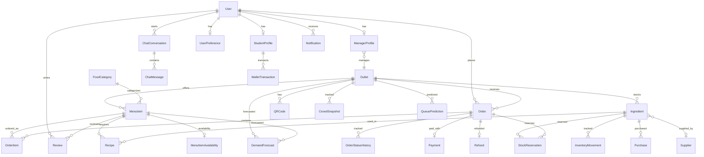

# Database Design

## Entity-Relationship Overview

## Tables Summary

| Table | Purpose | Key Relations |
|-------|---------|---------------|
| User | All system users | Has role-specific profiles |
| StudentProfile | Student-specific data | Linked to User |
| ManagerProfile | Manager-outlet assignment | Links User to Outlet |
| UserPreference | Dietary preferences | Linked to User |
| Outlet | Food outlets | Has menus, orders, inventory |
| FoodCategory | Menu categories | Groups MenuItems |
| MenuItem | Individual food items | Belongs to Outlet + Category |
| MenuItemAvailability | Daily limits, time windows | Per MenuItem |
| Ingredient | Raw ingredients | Per Outlet |
| Recipe | Ingredient requirements | Links MenuItem to Ingredient |
| InventoryMovement | Stock change history | Tracks all movements |
| StockReservation | Reserved stock for orders | Links Order to Ingredient |
| Supplier | Ingredient suppliers | Linked to Ingredients |
| Purchase | Ingredient purchases | Links Ingredient + Supplier |
| Order | Customer orders | Has items, payment, status history |
| OrderItem | Items within an order | Snapshots price at order time |
| OrderStatusHistory | Order lifecycle tracking | Full audit trail |
| Payment | Payment records | Linked to Order |
| Refund | Refund records | Linked to Order |
| WalletTransaction | Spending history | Linked to StudentProfile |
| Review | Food ratings | Links User + MenuItem |
| QRCode | Outlet QR codes | Signed tokens |
| CrowdSnapshot | Crowd measurements | Per Outlet, timestamped |
| QueuePrediction | Wait time estimates | Per Outlet |
| DemandForecast | Demand predictions | Per Outlet/MenuItem |
| ModelVersion | ML model metadata | Tracks versions + metrics |
| ChatConversation | Chat sessions | Per User |
| ChatMessage | Individual messages | Per Conversation |
| AIToolLog | AI tool call logs | Debugging aid |
| Notification | User notifications | Per User |
| AuditLog | System audit trail | Tracks sensitive actions |

## Key Design Decisions

1. **Soft Deletion**: Outlets and MenuItems use `deletedAt` for soft deletion to preserve historical data
2. **Price Snapshots**: OrderItem stores `price` at order time, decoupled from MenuItem.price
3. **Stock Reservation**: Two-phase: reserve on ACCEPTED, consume on PREPARING/READY, release on CANCEL/REJECT
4. **Decimal Precision**: Money uses `Decimal(10,2)`, stock uses `Decimal(10,3)`
5. **Idempotency**: Orders have an optional `idempotencyKey` to prevent duplicate submissions
6. **Data Labeling**: CrowdSnapshot and DemandForecast have `isSimulated`/`isSynthetic` flags
